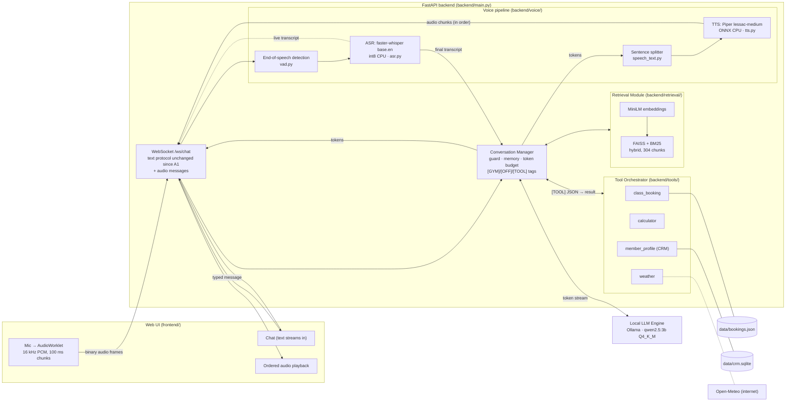

# IronPulse Fitness Assistant — Final Report (Assignments 1 + 2 + 3)

NLP Assignment 3 — Section B, Group 11
Kamram Ali (22i-2589), Ali Hamza (22i-2566)

A membership-desk assistant for a fictional gym, **IronPulse Fitness**, that runs **entirely on a laptop CPU**. You can type to it or **talk to it**. It answers from the gym's own documents, **acts** through tools (it books classes, does price maths, checks the weather for outdoor classes) and **remembers returning members**.

| Assignment | What it added | Still works the same in A3 |
|---|---|---|
| **A1** | Local LLM (Qwen2.5-3B, Ollama), FastAPI + WebSocket token streaming, session memory, on-topic guard, web chat UI | ✅ text protocol unchanged; all A1 protocol tests pass |
| **A2** | RAG over 65 gym documents: MiniLM embeddings + FAISS + BM25 hybrid search, token budget, citations | ✅ same retrieval for typed *and* spoken turns |
| **A3** | **Voice**: local ASR (faster-whisper) and TTS (Piper) streamed over the same WebSocket. **Tools**: `class_booking`, `calculator`, `weather`. **Bonus**: CRM tool `member_profile` | — |

**Where each A3 deliverable is**

| Deliverable (from the brief) | Where |
|---|---|
| Voice pipeline: browser capture and playback | [`frontend/app.js`](frontend/app.js) (AudioWorklet capture, ordered playback), section [4](#4-voice-pipeline) |
| Local ASR and TTS modules, streaming orchestration | [`backend/voice/`](backend/voice/) (`asr.py`, `tts.py`, `vad.py`, `speech_text.py`) + `TTSStreamer` in [`backend/main.py`](backend/main.py) |
| Setup instructions for the local models | section [1](#1-setup) and [`scripts/download_models.py`](scripts/download_models.py) |
| Tool orchestrator + three tools, each schema documented | [`backend/tools/`](backend/tools/), section [5](#5-tools) |
| Up-to-date architecture diagram | section [2](#2-architecture) |
| Model choices (LLM, ASR, TTS) | section [3](#3-model-choices) |
| Document collection and retrieval setup | section [6](#6-documents-and-retrieval-rag) |
| Each tool: name, description, schema, example of the LLM invoking it | section [5](#5-tools) |
| Latency benchmarks: ASR, retrieval, tools, LLM, TTS, end of speech → first audio | section [8](#8-latency-benchmarks) |
| Known limitations | section [11](#11-known-limitations) |
| Bonus: CRM tool | section [5.4](#54-bonus-member_profile-crm) |

---

## 1. Setup

You need **Python 3.10+**, **[Ollama](https://ollama.com/)**, a microphone, and about 3 GB of free disk space.

```powershell
# 1. The LLM. 2 parallel slots, so two users are served at the same time.
ollama pull qwen2.5:3b
$env:OLLAMA_NUM_PARALLEL = "2"; ollama serve          # (or set OLLAMA_NUM_PARALLEL=2 in Windows env vars and start the Ollama app)

# 2. Python environment (Windows PowerShell; macOS/Linux: source .venv/bin/activate)
python -m venv .venv
.venv\Scripts\Activate.ps1
pip install -r requirements.txt

# 3. The local speech models (one time, ~210 MB, then fully offline)
python scripts/download_models.py     # Whisper base.en -> models/whisper-base.en, Piper voice -> models/piper/

# 4. Run
uvicorn backend.main:app --host 127.0.0.1 --port 8000
```

Open **http://127.0.0.1:8000/**, then either type, or tap the **mic button** and speak. It stops listening by itself when you pause. **Voice replies** (top right) also speaks the answers to typed questions. The browser asks for microphone permission once; `localhost` counts as a secure origin, so it works over plain http.

- **Search index:** a built index is included in `index/`. Run `python scripts/build_index.py` only after changing `documents/` (it also downloads the 90 MB embedding model the first time).
- **Server status:** `GET /health` shows Ollama, the model, retrieval, ASR, TTS and the tool list.
- **If you move the folder:** recreate `.venv`, because its launchers store absolute paths.

| Environment variable | Default | Purpose |
|---|---|---|
| `OLLAMA_MODEL` | `qwen2.5:3b` | LLM (`qwen2.5:1.5b` is about twice as fast, less accurate) |
| `OLLAMA_HOST` | `http://127.0.0.1:11434` | where Ollama runs |
| `ASR_MODEL` | `base.en` | Whisper size: `tiny.en` (faster) / `base.en` / `small.en` (more accurate). Download it with `download_models.py --asr …` |
| `TTS_VOICE` | `en_US-lessac-medium` | Piper voice |
| `VAD_END_SILENCE_MS` | `600` | silence that ends an utterance |
| `GYM_CITY` | `Islamabad` | default city for the weather tool |
| `VOICE_ENABLED` | `1` | `0` = text only (skips loading Whisper and Piper) |
| `RETRIEVAL_MODE` / `RAG_MIN_SCORE` | `hybrid` / `0.35` | retrieval settings (A2) |

**Scripts**

| Command | What it does | Needs Ollama? |
|---|---|---|
| `pytest -q` | **167 automated tests** (fake LLM, ASR, TTS and embedder; about 20 s) | no |
| `python scripts/download_models.py` | download the local ASR and TTS models | no |
| `python scripts/build_index.py [--rebuild]` | offline indexing pipeline (incremental) | no |
| `python scripts/benchmark_tools.py` | each tool's latency on its own → `evaluation/tool_latency.md` | no |
| `python scripts/benchmark_retrieval.py` | retrieval latency on its own → `evaluation/retrieval_latency.md` | no |
| `python scripts/evaluate_retrieval.py` | retrieval quality: vector vs BM25 vs hybrid → `evaluation/retrieval_eval.md` | no |
| `python scripts/benchmark_voice.py [--concurrent]` | **per voice turn**: ASR, retrieval, tools, LLM first token, TTS, end of speech → first audio, optionally with 2 users at once → `evaluation/voice_latency.md` | yes |
| `python scripts/benchmark_latency.py` | text turns: retrieval, time to first token, tokens/s | yes |
| `python scripts/failure_tests.py` | live failure checks (bad input, stop, disconnect, concurrency) | yes |

---

## 2. Architecture

The Assignment 2 architecture plus a **voice pipeline** and a **tool orchestrator** next to the retrieval module. Everything runs on the local machine; the only network call is the weather tool's forecast lookup.



**One spoken turn, step by step**

1. **Capture.** You tap the mic. The browser sends `{"type":"audio_start"}`, then 100 ms chunks of 16 kHz 16-bit audio as binary WebSocket frames.
2. **Listen.** The server's end-of-speech detector (`vad.py`) finds the start of speech, then about 0.6 s of silence. While you speak, Whisper re-transcribes the audio so far about once per second, so you see a live transcript. Retrieval is also pre-fetched for that partial transcript.
3. **Transcribe.** At end of speech, Whisper transcribes the whole utterance into the **final transcript**, which goes into the **same** `ConversationManager.stream_reply()` as a typed message.
4. **Prepare the prompt.** Same history, same input guard, same RAG and the same prompt budget as text.
5. **Decide.** The LLM's reply starts with a tag:
   - `[GYM]`: it answers;
   - `[OFF]`: a fixed polite refusal is sent instead;
   - `[TOOL]`: it calls a tool (section 5).
6. **Stream.** Tokens stream to the chat as `token` frames, exactly as in A1. At the same time a sentence splitter hands each finished sentence to Piper, and its audio goes back in numbered chunks that the browser plays in order. The voice starts on sentence 1 while the LLM is still writing sentence 2.
7. **Report.** After the reply, the server sends a `metrics` frame with this turn's latencies, shown in small print under the answer.

---

## 3. Model choices

| Role | Model | Why |
|---|---|---|
| **LLM** | **Qwen2.5-3B-Instruct, Q4_K_M** via Ollama (`qwen2.5:3b`, 1.9 GB) | Within the 0.5B–4B range. It follows long system prompts and our tag protocol reliably. In A1 we compared it with `qwen2.5:1.5b` on 19 live test conversations: **3B passed 55/57 scenario runs against 16/19 for 1.5B**, and 1.5B made factual errors ("we don't offer a freeze") and answered off-topic questions. 3B generates about 6 tokens/s on an i3 CPU. Settings: temperature 0.2, `num_ctx` 8192 (A3 needs room for the tool list and tool results), reply cap 320 tokens, `keep_alive` 30 min. |
| **ASR** | **faster-whisper `base.en`, int8** (Whisper on CTranslate2) | Fully local and accurate on short English questions. CTranslate2 int8 is the fastest way to run Whisper on a CPU. `base.en` is the balance point: `tiny.en` is faster but drops more words, `small.en` is about 3× slower. Two extra accuracy measures:<br>• we pass gym vocabulary as Whisper's `initial_prompt` (plan names, class names, trainer names);<br>• we fix the few words it still mishears ("hit class" → "HIIT class", "pilots" → "Pilates"). |
| **TTS** | **Piper `en_US-lessac-medium`** (VITS model in ONNX, 63 MB) | Fully local, natural voice, and much faster than real time on a CPU (about 0.4 s to synthesise a 2.7 s sentence on our i3). It synthesises one sentence at a time, which is exactly what streaming needs. |
| **End of speech** | Energy-based detector with an adaptive noise floor (`vad.py`, no model) | Microseconds per chunk. The browser already applies echo cancellation and noise suppression. |
| **Embeddings (A2)** | `all-MiniLM-L6-v2` (sentence-transformers, CPU) | 22M parameters, about 12 ms per query; see section 6. |

---

## 4. Voice pipeline

### 4.1 WebSocket protocol: text unchanged, audio added alongside

The **text API contract from Assignment 1 is unchanged**: same message types, same `token` … `done` sequence, same error codes. A typed message with voice replies off produces exactly the A1 frames (`test_typed_message_without_voice_has_no_extra_frames`). Binary frames are still rejected with `invalid_frame` unless an audio stream has been started (`test_binary_audio_without_audio_start_is_still_rejected`). The A1 protocol tests in `tests/test_websocket_errors.py` pass with the same assertions.

**Added client → server messages**

| Message | Meaning |
|---|---|
| `{"type": "audio_start", "sample_rate": 16000}` | Start listening. Then send **binary frames**: 16-bit little-endian mono PCM at 16 kHz, 100 ms each. If a reply is playing, it is stopped (barge-in). |
| `{"type": "audio_end"}` | The member tapped the mic again: end the utterance now. |
| `{"type": "audio_cancel"}` | Discard the utterance. |
| `{"type": "tts", "enabled": true}` | "Voice replies": also speak answers to typed messages. |
| `/ws/chat?user_id=<id>` (connection URL) | A browser-kept member ID for the CRM (bonus). The URL is not a message, so the message contract is untouched. |

**Added server → client messages**

| Message | Meaning |
|---|---|
| `listening` | Audio is being received. |
| `speech_start`, `speech_end` | Detected start and end of speech. |
| `transcript` `{final: false, text}` | Live transcript while speaking. |
| `transcript` `{final: true, text, asr_ms}` | The final transcript. The reply follows as normal `token` frames and `done`. |
| `audio` `{seq, sample_rate, format: "pcm_s16le", data, text}` | A piece of speech (≤ 0.5 s, base64). `seq` gives the play order; `text` is the sentence it belongs to. |
| `audio_done` | No more audio for this turn. |
| `metrics` | Per-turn latencies (section 8). |
| `member` `{name, visits, last_question}` | A returning member was recognised (CRM bonus). |
| `error` codes `no_speech`, `voice_unavailable`, `asr_error`, `tts_error` | Voice-specific failures. The connection always stays usable, and text keeps working. |

### 4.2 Speech-to-text: streaming, end-of-speech, final transcript

**In the browser** (`frontend/app.js`):
- An **AudioWorklet** runs on the audio thread. It resamples the microphone from the device rate (usually 48 kHz) to 16 kHz with linear interpolation, converts to 16-bit PCM, and posts 1600-sample (100 ms) chunks, which go straight onto the WebSocket.
- `getUserMedia` has echo cancellation, noise suppression and auto-gain turned on.

**On the server** (`main.py` `_on_audio`, `vad.py`, `asr.py`):

1. **Cut into frames.** Every chunk is appended to the utterance buffer and split into 30 ms frames.
2. **Speech or not.** A frame counts as speech if its loudness (RMS) is above `max(0.012, 3 × noise floor)`. The noise floor is learned from the non-speech frames.
3. **Start and end.** Speech starts after 150 ms of speech frames and ends after **600 ms of silence**, with hysteresis so short pauses don't cut a sentence. There is an 8 s timeout if nobody speaks and a 30 s maximum utterance.
4. **Live transcript.** While speaking, the utterance so far is re-transcribed about once per second in the ASR thread pool and sent as `transcript {final: false}`. The same text is used to **pre-fetch retrieval**, so retrieval is already cached when the final transcript matches.
5. **Final transcript.** At end of speech, Whisper transcribes the full utterance (greedy decoding, English, vocabulary prompt) and sends `transcript {final: true}`.
6. **Reply.** The transcript then goes to `_stream_to_client(..., speak=True)`, the same path typed messages take.

### 4.3 Text-to-speech: sentence by sentence while the LLM streams

`TTSStreamer` in `main.py`:
1. **Split.** Every streamed token is fed to `SentenceSplitter`. A sentence is released the moment it ends (`.`, `!`, `?` followed by a space, or a newline). The **first** piece may end at a comma once it is 35+ characters long, so the first audio starts sooner.
2. **Clean up for speaking.** `speakable()` removes markdown and turns "24/7" into "twenty-four seven" and "$49/month" into "$49 per month". The server-added "Sources:" line is shown but not spoken.
3. **Synthesise in order.** One worker per turn takes sentences in order and synthesises each in the TTS thread pool. The audio goes out in ≤ 0.5 s numbered pieces while the LLM keeps writing.
4. **Play in order.** The browser decodes each piece into an `AudioBuffer` and schedules it right after the previous one (`playHead`), so playback is gap-free and in order. The text keeps appearing in the chat at the same time.
5. **Stop and barge-in.** Pressing Stop, or tapping the mic while it is talking, cancels both the LLM stream and the TTS worker. The browser also stops audio that is already playing.

**Tool turns (speaking while the tool runs).** When the model starts writing a tool call, the server recognises the tool name in the first few tokens. It then plays a short **pre-synthesised acknowledgement**, such as "Let me check the booking calendar.", while the JSON is finished, the tool runs and the model writes the answer. A person at a front desk would do the same.
- It is **audio only**: the chat shows just the real answer.
- The metrics report **first audio** and **first answer audio** separately, so the acknowledgement doesn't hide the real latency.

---

## 5. Tools

### 5.0 How the orchestrator works: prompt-based function calling

We use **prompt-based function calling**, built on the tag protocol from A1. The code is in `backend/tools/orchestrator.py` and `ConversationManager.stream_reply`.

1. **Tools in the prompt.** The system prompt (`backend/data/gym_context.py`) lists every tool's **name, description and JSON schema**, generated from the tool definitions. It also gives rules for when to use each tool, and examples. The list is static, so it stays in Ollama's prompt cache.
2. **The model decides.** Every reply starts with a tag. To use a tool, the model writes **only**: `[TOOL] {"name": "...", "arguments": {...}}`
3. **Detect.** The manager reads the tag before anything reaches the user. On `[TOOL]` it collects the JSON silently (string-aware brace matching), **stops generation** as soon as the object is complete, and calls `orchestrator.call()`.
4. **Check and run.** `orchestrator.call()`:
   - checks the arguments against the tool's JSON schema (`jsonschema`);
   - runs the tool **asynchronously with its own timeout** (`asyncio.wait_for`; blocking file and SQLite work runs in a worker thread);
   - **never raises**. An unknown tool, invalid JSON, wrong arguments, a timeout or an exception all become `{"ok": false, "error": "…"}`.
5. **Feed the result back.** The call and its result are added to the conversation: `assistant: [TOOL] {…}`, then `user: TOOL RESULT from <tool>: {…} Now reply…`. The LLM is called again and **streams the final answer** (`[GYM] …`), spoken in voice mode. A failed tool gets a plain explanation.
6. **Limits.** At most **2 tool calls per turn**, then the model must answer, so a confused model can't loop. The result text is capped at 1,500 characters, and 1,200 tokens of the context budget are reserved for tool rounds.
7. **Trusted identity.** The member's identity (CRM user ID, name, plan) comes from the **server**, never from the LLM's arguments, so the model cannot act for someone else.

Tools work the same from typed and spoken requests, because voice and text share this code path.

### 5.1 Tool 1 — `class_booking` (local calendar file)

**What it's for:** check spots, book, cancel, and list group-class bookings. The booking calendar is `data/bookings.json`.

**Rules it enforces** (all from IronPulse's own documents):
- bookings open 7 days ahead, with at most 4 future bookings;
- class capacity is respected, and a full class points to the waitlist;
- Plus = 1 class per week, and Basic/Student plans can't book;
- the gym is closed on 25 Dec and 1 Jan;
- a class that has already started can't be booked;
- "Friday" said on a Friday evening, after Friday's class, means next Friday;
- a cancellation less than 2 hours before the class is flagged as a used class.

**Simulated occupancy:** so availability looks realistic, each session starts with a fixed number of "other members" (40–90% of capacity, derived from the class and date).

| | |
|---|---|
| **Description (as the LLM sees it)** | IronPulse group-class booking calendar. action=availability: spots left for a class/day; book: book the member into a class; cancel: cancel their booking; list: their upcoming bookings. |
| **Timeout** | 3 s |

```json
{
  "type": "object",
  "properties": {
    "action": {"type": "string", "enum": ["availability", "book", "cancel", "list"]},
    "class_name": {"type": "string", "description": "HIIT, Yoga, Spin, Pilates, Strength, Boxing, Core, Bootcamp or Restorative Yoga"},
    "date": {"type": "string", "description": "a weekday like \"Friday\", \"today\", \"tomorrow\" or YYYY-MM-DD"},
    "member_name": {"type": "string", "description": "the member's first name (needed to book, cancel or list)"}
  },
  "required": ["action"],
  "additionalProperties": false
}
```

**Example from a live run** (spoken; real Whisper, Qwen and Piper on our laptop, a Friday afternoon):
> 🎤 **Member (heard as):** "Please book me into spin on Friday, my name is Sarah."
> **LLM →** `[TOOL] {"name": "class_booking", "arguments": {"action": "book", "class_name": "Spin", "date": "Friday", "member_name": "Sarah"}}`
> 🔊 *"Let me check the booking calendar."* (acknowledgement while the tool runs)
> **Tool →** `{"ok": true, "result": {"booked": true, "id": "BK-1001", "class": "Spin", "date": "2026-10-30", "time": "7:00am", "trainer": "Jordan Lee", "note": "Plan not verified: classes need Plus or Elite; …"}}`
> **Assistant (shown and spoken):** "Sarah, I've booked you into Spin on Friday at 7:00am with Jordan Lee. Your plan needs to be verified as Plus or Elite, so please check in at the front desk. Enjoy your workout!"
> *Sources: Spin · Tools: class_booking*

### 5.2 Tool 2 — `calculator` (price maths)

**Why it's useful:** a 3B model gets multi-step arithmetic wrong, so for any price maths it writes the expression and this tool evaluates it exactly. Examples: a year of a plan, prorated upgrades, freeze months, personal-training packs.

**Safety:** the expression is parsed into a Python AST and **only numbers, `+ - * / // % **`, brackets and `round()`** are evaluated. It never uses `eval()`, so no code can run, and huge exponents are refused.

| | |
|---|---|
| **Description** | Evaluate an arithmetic expression exactly. Use it for any maths on IronPulse prices: yearly cost, several months, freeze fees, prorated upgrades, personal-training packs, per-session prices. |
| **Timeout** | 2 s |

```json
{
  "type": "object",
  "properties": {"expression": {"type": "string", "description": "Arithmetic using numbers, + - * / ( ) and round(), e.g. \"79*12 + 460\""}},
  "required": ["expression"],
  "additionalProperties": false
}
```

**Example from a live run** (typed, real model). The prices came from the retrieved documents; the arithmetic came from the tool:
> **Member:** "How much would a year of Elite plus a 10-session personal training pack cost?"
> **LLM →** `[TOOL] {"name": "calculator", "arguments": {"expression": "79*12 + 460"}}`
> **Tool →** `{"ok": true, "result": {"expression": "79*12 + 460", "result": 1408}}`
> **Assistant:** "A year of Elite membership plus a personal training 10-session pack would cost $1408."
> *Sources: Price List and Fees; Personal Training Packages; … · Tools: calculator*

### 5.3 Tool 3 — `weather` (free Open-Meteo API)

**Why a gym needs it:** the Saturday Bootcamp is outdoors and, per `documents/classes/bootcamp.md`, **moves indoors in heavy rain, lightning or above 35 °C**. The tool returns the current weather, today's forecast, and that Bootcamp advice.

**Why Open-Meteo:** it's free and needs **no API key**, so the project runs anywhere without sign-up. It is the only tool that uses the internet.

**Kept fast and safe:**
- City coordinates are cached forever, and forecasts are fresh for 10 minutes.
- When a forecast is older than 10 minutes (and less than 3 hours), the cached one is returned **at once** and refreshed in the background (stale-while-revalidate).
- The gym city's forecast is pre-fetched at server start.
- Offline, it returns *"The weather service can't be reached right now"* instead of hanging.

| | |
|---|---|
| **Description** | Current weather and today's forecast for a city, plus whether the outdoor Saturday Bootcamp would move indoors. If the member doesn't name a city, leave it out (default: Islamabad). |
| **Timeout** | 6 s |

```json
{
  "type": "object",
  "properties": {"city": {"type": "string", "description": "city name, e.g. \"Islamabad\""}},
  "required": [],
  "additionalProperties": false
}
```

**Example of the call format** (taught to the model in the system prompt; the tool result below is real Open-Meteo output from our tool benchmark):
> **Member:** "Will it rain for Bootcamp this Saturday?"
> **LLM →** `[TOOL] {"name": "weather", "arguments": {}}`
> **Tool →** `{"ok": true, "result": {"city": "Islamabad, Pakistan", "now": {"temperature_c": 21.1, "conditions": "partly cloudy", …}, "today": {…}, "bootcamp_advice": "Bootcamp would run outdoors as normal (it runs in light rain). …"}}`

### 5.4 Bonus — `member_profile` (CRM)

**What it stores:** a member's name, email, phone, plan, preferences, notes and **past questions**, across sessions. It's a local SQLite file (`data/crm.sqlite`) keyed by a **user ID that the browser keeps** in `localStorage` and sends in the WebSocket URL.

The brief's three requirements:
1. **Store** (keyed by user ID): the `members` and `interactions` tables. Every question the member asks is logged as a past interaction.
2. **Retrieve at the start of a returning session:**
   - On `new_session`, the server loads the profile and sends a `member` frame.
   - The UI greets: **"Welcome back, Sara! Last time you asked: 'How do I freeze my membership?'. What can I help you with today?"**
   - The profile (name, plan, preferences, last questions) is also added to the LLM's member context, with an instruction to greet returning members by name and mention their last visit.
3. **Update during the conversation:** the **LLM calls** `member_profile` (`action: "update"`) as soon as the member gives new details. It calls `action: "get"` when asked what it remembers. Updated details are applied to the current session straight away.

It works in voice mode too: it's the same tool path, and the acknowledgement is *"Sure, let me note that."*

| | |
|---|---|
| **Description** | The member's saved profile (remembered across visits). action=get: read what we know about them. action=update: save new details the member just told you (name, email, phone, plan, preferences, notes). |
| **Timeout** | 3 s |

```json
{
  "type": "object",
  "properties": {
    "action": {"type": "string", "enum": ["get", "update"]},
    "name": {"type": "string"}, "email": {"type": "string"}, "phone": {"type": "string"},
    "plan": {"type": "string", "description": "Basic, Student, Plus or Elite"},
    "preferences": {"type": "string", "description": "e.g. \"prefers evening classes\""},
    "notes": {"type": "string", "description": "anything else worth remembering, e.g. \"knee injury\""}
  },
  "required": ["action"],
  "additionalProperties": false
}
```

**Example of the call format** (from the system prompt):
> **Member:** "By the way my email is sara@example.com"
> **LLM →** `[TOOL] {"name": "member_profile", "arguments": {"action": "update", "email": "sara@example.com"}}`
> **Tool →** `{"ok": true, "result": {"updated": ["email"], "profile": {"name": "Sara", "email": "sara@example.com", "visits": 2, "recent_questions": […]}}}`

Validation: emails and phone numbers are checked, plan names are normalised, and preferences are appended rather than overwritten. Without a user ID, the tool replies that nothing can be saved.

### 5.5 Tool failure handling

| Failure | Result (never a hang or crash) | Test |
|---|---|---|
| Tool takes too long | stopped at its timeout → `"The X tool took longer than N s…"`, and the LLM apologises | `test_timeout_and_crash_never_hang_or_raise` |
| Exception inside a tool | `"The X tool failed unexpectedly (…)"` | same |
| Unknown tool, invalid JSON, arguments not matching the schema | rejected **before** running, with the reason | `test_invalid_calls_are_rejected_before_running`, `test_bad_tool_call_text` |
| Business-rule failure (class full, wrong day, Basic plan…) | clear message the LLM relays | `test_booking_rules`, `test_full_class_and_started_class` |
| Weather offline | "can't be reached right now" | `test_weather_offline_gives_a_sensible_message` |
| Model keeps calling tools | after 2 calls: *"Sorry, I couldn't complete that just now…"* | `test_endless_tool_calls_are_cut_off` |

---

## 6. Documents and retrieval (RAG)

From Assignment 2, unchanged, and used by both text and voice turns.

**Document collection:** 65 markdown documents (about 10,800 words) written for IronPulse, consistent with A1 but with far more detail than a model could guess:

| Folder | Docs | Contents |
|---|---|---|
| `plans/` | 7 | Basic, Student, Plus, Elite, comparison, corporate programme, full price list |
| `classes/` | 12 | Weekly schedule, one page per class (capacity, level, late-entry rules), booking and waitlist, etiquette |
| `trainers/` | 7 | Five trainer bios, personal-training packages, free intro session |
| `policies/` | 19 | Freeze, medical freeze, cancellation, cooling-off, upgrades, guests, age, billing, failed payments, conduct, dress code, filming, equipment, health clearance, 24/7 hours, access cards, privacy, children and pets, lost and found |
| `facilities/` | 10 | Opening hours, holidays, location, parking, equipment, sauna, changing rooms, recovery zone, accessibility, amenities |
| `faq/` | 10 | Joining, first visit, tours, member app, freeze-or-cancel, classes, day passes, events, gift memberships, new members |

**Indexing pipeline** (`scripts/build_index.py`):
- **Chunking:** each document is split at its `##` section headings (max 900 characters, 1 item of overlap), and every chunk starts with "Title — Section". Result: **304 chunks**.
- **Embedding:** `all-MiniLM-L6-v2` on the CPU.
- **Vector store:** **FAISS** `IndexFlatIP`, exact cosine search (instant at this size, no server process).
- **Re-runnable:** embeddings are cached per chunk hash, so a re-run only embeds new or edited chunks (0 after no change, 1 after editing one document) and removes deleted ones.

**Retrieval for every message:**
- **Search:** **hybrid** BM25 + vector, merged with Reciprocal Rank Fusion; **top-k = 4**.
- **Relevance gate:** chunks below cosine **0.35** are dropped. If nothing is left, the model is told "no document matched" and says so instead of making something up.
- **Query rewriting:** "today"/"tomorrow" become weekday names, and short follow-ups are joined with the previous question.
- **Caching:** LRU caches for query embeddings and results, pre-warmed for common questions. In voice mode, partial transcripts **pre-fetch** retrieval.
- **Never blocks:** runs in a thread pool with a 2 s timeout; any failure means "search unavailable" and the conversation carries on.

**Context-window budget** (`num_ctx` 8192, estimated as characters ÷ 3, which deliberately over-counts):
- **Reserved:** 320 tokens for the reply, a 150-token safety margin, and **1,200 tokens for tool calls and results**.
- **Then filled in priority order:** system prompt (with tool specs) > question and member context > documents (≤ 1,000 tokens) > history, newest first, up to 12 turns.
- **Prompt caching:** everything that changes per turn is in the **last** message, so Ollama reuses the cached system prompt and history.

**Citations:** after a grounded answer, the server adds `Sources: <document titles> · Tools: <tools used>`, shown in the chat and not spoken.

**Retrieval quality** (52 labelled paraphrased questions, `evaluation/retrieval_eval.md`):

| Method | Hit@1 | Hit@4 | MRR |
|---|---|---|---|
| Vector | 71% | 92% | 0.809 |
| BM25 | 60% | 75% | 0.693 |
| **Hybrid (used)** | 69% | **98%** | **0.814** |

Gate: 51/52 answerable questions kept, 12/12 off-topic questions rejected.

---

## 7. Conversation behaviour (from Assignment 1, in text and voice)

- **Memory:** a session keeps up to 12 recent turns, plus **pinned member details** (name, plan, plans asked about, CRM profile) that survive older turns being dropped. Voice and text share one history: say something, then type a follow-up, and it is remembered.
- **Staying on topic, three layers:**
  1. a rule-based guard for clear off-topic and jailbreak messages (no retrieval or model call);
  2. the model's own `[OFF]` tag;
  3. prompt rules.

  Refusals are fixed, polite and in character.
- **Persona and rules:** never waives fees or invents discounts; doesn't reveal its instructions; stays IronPulse's assistant; refers medical questions to a doctor. It never claims a booking happened unless `class_booking` confirmed it.
- **Streaming and control:** token streaming, Stop button, one turn at a time (`busy`), barge-in by voice.
- **Robustness:** reconnects automatically, cleans up sessions, and malformed input never closes the connection.

---

## 8. Latency benchmarks

Brief targets: about 1 s, and at most about 2 s, from **end of speech to first audio**; retrieval plus tools adding at most about 2 s before generation starts.

**Measurement machine (development laptop):** Intel Core i3-10110U, **2 cores / 4 threads**, 7.8 GB RAM, **no GPU**, Windows 11. Everything (Whisper, MiniLM, Ollama with Qwen 3B, and Piper) shares those 2 cores. All numbers below were measured on it.

### 8.1 Components on their own

| Component | Measured | Script / source |
|---|---|---|
| **ASR** (Whisper base.en, int8) | **1.5–1.8 s** for a 2.6–2.8 s spoken question (model load 6 s, once) | ASR check in development; `asr_ms` in every voice turn |
| **Retrieval** (hybrid, uncached) | **12 ms** mean (embedding 11.6 ms + search 0.6 ms) | `benchmark_retrieval.py` |
| **Retrieval** (cached / pre-fetched) | **0.2 ms** | same |
| **Tools** | calculator 0.5–9 ms · class_booking 1–13 ms · member_profile 2–25 ms · weather 0.0 ms cached (2.0–2.8 s for the first internet fetch, done at start-up) | `benchmark_tools.py` → `evaluation/tool_latency.md` |
| **LLM first token** (prompt cached) | **5.5–10 s** (time to read the documents and question for this turn, at about 22 prompt tokens/s on this CPU) | `llm_first_token_ms` in metrics |
| **LLM generation** | about 6 tokens/s | `benchmark_latency.py` |
| **TTS** (Piper, one sentence) | **0.37–0.48 s** when idle; about 1.5 s while the LLM shares the CPU | development check; `tts_first_audio_ms` |

Retrieval and tools together stay **well under the 2 s budget**: 24–26 ms retrieval and 5–101 ms tools in the live voice turns.

### 8.2 Live voice turns (end of speech → first audio), same laptop

| Spoken question | ASR | Retrieval | Tools | LLM first token | TTS | End of speech → first audio |
|---|---|---|---|---|---|---|
| "Are there any spots left in Pilates on Friday?" (`class_booking`; before the acknowledgement was added) | 1.79 s | 26 ms | 5 ms | 5.51 s | 1.50 s | 32.5 s |
| "Please book me into Spin on Friday. My name is Sara." (`class_booking`) | 1.84 s | 24 ms | 101 ms | 10.16 s | — | acknowledgement at **20.4 s**, answer audio at 36.9 s |

The second run was measured *before* the final optimisation, which now starts the acknowledgement as soon as the tool **name** appears instead of after the whole JSON. `python scripts/benchmark_voice.py --concurrent` produces this full table on any machine (one user, then two users speaking at once) and writes `evaluation/voice_latency.md`.

### 8.3 Honest assessment of the target

On a **2-core CPU laptop** the end-of-speech → first-audio target of about 1–2 s is **not reached**. The parts we control are all fast: ASR 1.8 s, retrieval 0.02 s, tools 0.1 s, TTS under 0.5 s per sentence. What dominates is the LLM: a 3B model on 2 cores reads new prompt text at about 22 tokens/s and writes at about 6 tokens/s. Every turn has to read that turn's retrieved documents (a few hundred tokens), and a **tool turn needs two LLM passes** (write the call, then the answer). We measured this directly in A2: 320 new prompt tokens took 14 s, while the cached part took 0.7 s.

What the design does to get as close as possible:
- **Prompt caching:** the static system prompt and tool list come first, and all per-turn text goes last, so only new tokens are processed.
- **Two parallel slots:** `OLLAMA_NUM_PARALLEL=2` gives each concurrent user their own slot and prompt cache.
- **Retrieval pre-fetch:** retrieval is pre-fetched from the live transcript while the member is still speaking.
- **Early speech:** speaking starts at the first sentence, or the first clause; the LLM never has to finish first.
- **Instant acknowledgement:** on tool turns, a pre-synthesised acknowledgement plays the moment the tool is named.
- **Fast tools:** weather is pre-fetched and served stale-while-revalidate; all other tools are local and take milliseconds.
- **Bounded waits:** an end-of-speech window of 600 ms, `num_predict` 320, low temperature.

On faster hardware, the same pipeline gets much closer to real time without code changes. Expected levers (we haven't measured these ourselves):
- a newer CPU with more cores, such as a 12th-gen Core i5, processes prompts several times faster;
- `OLLAMA_MODEL=qwen2.5:1.5b` roughly halves LLM time, at some accuracy cost (section 3);
- `ASR_MODEL=tiny.en` cuts ASR to a fraction.

### 8.4 Two concurrent users

- **The server never blocks.** Each WebSocket has its own task and session lock. Whisper (2 workers) and Piper run in separate thread pools, and retrieval in its own pool, so the event loop always keeps running.
- **Tested with two voice users at once** (`test_two_voice_users_at_once`). Live text concurrency was tested in A1/A2 (3 users, all served).
- **Ollama with `OLLAMA_NUM_PARALLEL=2`** generates for both users at once. On a CPU, each then runs slower because they share the cores, but neither waits for the other to finish.

---

## 9. Testing

`pytest -q` runs **167 tests in about 20 s**, with no Ollama, Whisper, Piper or embedding model needed (fakes for all of them):

| File | What it proves |
|---|---|
| `tests/test_voice.py` | **Voice:**<br>• end-of-speech detection (start, end, waiting for enough silence, no-speech timeout);<br>• sentences released while streaming, first piece at a comma;<br>• speakable text;<br>• the full spoken turn over the WebSocket: transcript → shared history → tokens → in-order audio chunks ≤ 0.5 s → metrics;<br>• **first audio sent before the reply is finished**;<br>• live transcript and manual end;<br>• silence error;<br>• voice unavailable while text still works;<br>• binary frames still rejected outside audio;<br>• typed message with voice replies;<br>• **typed message without voice = exactly the A1 frames**;<br>• barge-in;<br>• TTS failure keeps the text;<br>• **acknowledgement before the tool answer**;<br>• **two voice users at once** |
| `tests/test_tools.py` | Every tool documented with a valid JSON schema; calculator correctness and safety; booking rules (window, capacity, plan, wrong day, started class, Plus one per week, next-week roll-over), list and cancel; weather cache, stale-while-revalidate and offline handling; Bootcamp rules; orchestrator rejects bad calls and survives timeouts and crashes; CRM update, get, returning session and validation |
| `tests/test_tool_calling.py` | `[TOOL]` detected even when split across tokens; generation stops when the call is complete; result fed back and answer streamed; the call is never shown; failures explained; endless tool calls cut off; tools in the cached system prompt; timings recorded; **CRM update used in the same session; returning member recognised and their interaction logged** |
| `tests/test_conversation_manager.py`, `test_retrieval.py`, `test_guard.py` | A2 RAG (budget, citations, no-match and failure fallbacks, incremental indexing) and A1 behaviour |
| `tests/test_websocket_errors.py` | The A1 text WebSocket contract, same assertions |

---

## 10. Project layout

```
backend/
  main.py                    FastAPI app; /ws/chat text protocol (A1) + voice messages; TTS streamer; metrics
  conversation/manager.py    sessions, memory, guard, retrieval, token budget, [GYM]/[OFF]/[TOOL] handling, CRM hooks
  conversation/guard.py      rule-based first layer against off-topic / jailbreak input
  data/gym_context.py        system prompt: persona, rules, tool instructions, output format (no gym facts)
  llm/ollama_engine.py       async streaming client for Ollama + generation settings
  retrieval/                 chunking, indexing pipeline, hybrid retriever (A2)
  tools/                     orchestrator + class_booking, calculator, weather, member_profile (CRM)
  voice/                     vad.py (end of speech), asr.py (faster-whisper), tts.py (Piper), speech_text.py
frontend/                    index.html, app.js (mic AudioWorklet, playback, metrics), styles.css
documents/                   65 IronPulse documents (A2)
index/                       built FAISS index + chunk metadata + embedding cache
models/                      downloaded ASR/TTS models (not committed; scripts/download_models.py)
data/                        bookings.json and crm.sqlite, created at runtime (not committed)
scripts/                     download_models, build_index, benchmarks, evaluations, failure tests
evaluation/                  benchmark and evaluation reports
tests/                       167 tests
```

---

## 11. Known limitations

- **Latency on a CPU laptop** (section 8.3): end of speech → first answer audio is tens of seconds on our 2-core i3 because of the 3B LLM, not 1–2 s. The acknowledgement covers part of the wait on tool turns. Faster hardware, a smaller LLM or a smaller Whisper are the levers.
- **CPU contention:** Whisper, Piper and the LLM share the same cores, so under load each one slows the others; for example, TTS of the first sentence went from 0.4 s idle to 1.5 s while the LLM was generating.
- **End-of-speech detection is energy-based:** in a noisy room it can end late or take noise as speech. The manual mic tap always ends listening, and the browser's noise suppression helps.
- **ASR accuracy:** `base.en` can mishear names, for example "Sara" became "Sarah" in our live test. Uncommon gym words are corrected only for the patterns we listed.
- **Tool calling relies on a 3B model** following the `[TOOL]` format. In our live tests it called `calculator` and `class_booking` correctly, from text and from speech. If it writes a malformed call, the orchestrator reports it, and after 2 attempts the member gets a polite fallback.
- **The booking calendar is a local file:**
  - other members' occupancy is simulated;
  - there are no real payments or membership changes;
  - a booking is not tied to a verified membership. The tool notes when the plan wasn't verified, and the front desk confirms at check-in.
- **The weather tool needs internet** (the only non-local part). It's cached and pre-fetched, and fails gracefully offline.
- **CRM identity is per browser** (a random ID in `localStorage`): a different browser or cleared storage means a new member record. There is no login, which is fine for a demo but not for real personal data.
- **Two concurrent users:** both are served at once (`OLLAMA_NUM_PARALLEL=2`), but on a CPU each runs slower while both are active.
- **No echo-proof barge-in while the assistant is talking:** the microphone is only open while you are speaking a turn, and tapping the mic stops the voice first.
